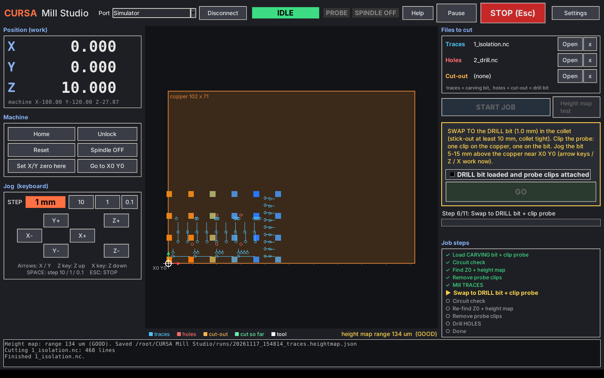

# CURSA Mill Studio

PCB isolation milling on a cheap desktop CNC, without the fiddling.
One window to jog the machine, auto-level the copper with a probe height map, and run a guided
**two-bit job**: carve the traces, swap to the drill, re-probe, drill the holes and cut the board out.

Built for the **Genmitsu 3018-PROVer V2** (GRBL 1.1). Should work on any GRBL 1.1 machine with a probe input.



## What it does

- **Machine control**: connect (auto-finds the GRBL port), Home, Unlock, Reset, live DRO, PROBE and spindle lights,
  Pause / Resume, big STOP (Esc).
- **Keyboard jogging**: arrows = X / Y, **Z** = Z up, **X** = Z down, **Space** = step 10 / 1 / 0.1 mm.
- **Files**: pick the traces file, the holes file and (optional) the cut-out file. Live preview of all three on the
  copper, with the tool position and the probed height map.
- **Auto-levelling**: blind touch-off for Z0, then a G38.3 height map over everything that will be cut (≤ 10 mm grid,
  automatic refinement, stops if the blank is not seated). Every cutting move is corrected for the copper height
  while streaming.
- **Guided job**, each spindle start behind a dual confirm (tick + GO):
  1. Load the carving bit, clip the probe → circuit check → Z0 + height map
  2. Remove the clips → mill traces
  3. Swap to the drill bit, clip the probe → circuit check → Z0 re-found + height map again
  4. Remove the clips → drill holes → cut-out
- **Backlash compensation** in software (GRBL 1.1 has none), set from a test coupon.
- **Simulator**: choose `Simulator` as the port to rehearse the whole flow with a fake machine and a warped blank.

## Install (Windows)

1. Install Python 3.9+ from [python.org](https://www.python.org/downloads/) (tick **Add python.exe to PATH**).
2. Open Command Prompt and run once:

   ```
   py -m pip install https://github.com/<you>/cursa-mill-studio/archive/refs/heads/main.zip
   ```

3. Start it:

   ```
   pyw -m cursa_studio
   ```

   On the first start it offers a **Desktop + Start Menu shortcut**. After that, just double-click the shortcut.

**No install?** Download the repo ZIP, extract it, run `py -m pip install numpy pyserial` once, then double-click
`CURSA Mill Studio.pyw`.

> **Smart App Control / SmartScreen**: the app runs inside the signed Python interpreter (`pythonw.exe`), so Windows
> Smart App Control does not block it. Unsigned `.exe` builds of it are blocked by Smart App Control.

Linux: `pip install .` then `python -m cursa_studio` (needs `python3-tk`).

## First run on a real machine

1. Close any other sender (Candle etc.): only one program can use the port.
2. E-stop released, **Connect**, **Home**.
3. Jog the bit over the lower-left corner of the copper, click **Set X/Y zero here**.
   (Z zero is found by probing — never set it by hand.)
4. Run **Height map test** on a scrap blank with a hand on the e-stop for the first touch.
5. Pick the files, **START JOB**, follow the prompts.

### Probe wiring

The copper blank is the probe plate: one clip on the copper, the other on the bit (or the spindle body), wired to the
controller's probe input. The circuit check before each touch-off makes sure the probe actually closes — a broken
clip would otherwise send the bit 25 mm into the board.

## Settings and files

`Documents\CURSA Mill Studio\` holds `settings.json` (copper size, backlash X/Y, spindle speed, probe spacing, jog
feeds, last files) and `runs\` (every height map as JSON).

## G-code expectations

- Absolute coordinates (G90), mm, X0 Y0 = copper lower-left corner, Z0 = copper surface.
- Cutting moves have Z < 0. Arcs (G2/G3) are split into short segments for levelling.
- If a file has no `M3`, the app adds `M3 S<spindle>` and a 3 s dwell.

## Command line

`python -m cursa_studio.core job traces.nc holes.nc ...` runs the same job in a terminal;
`python -m cursa_studio.core map` is the height map test. `--help` for the rest.

## Development

```
pip install -e ".[dev]"
pytest
```

The tests run complete jobs on the simulator (`cursa_studio/sim.py`) and check cut depths, drill depths, no rapid moves
into the copper and no cutting with the spindle off.

## Safety

This software moves a spinning cutter. Keep a hand near the e-stop, wear eye protection, and verify every new setup
with the Simulator and the Height map test first. Provided as is, without warranty (see LICENSE).

## License

MIT
